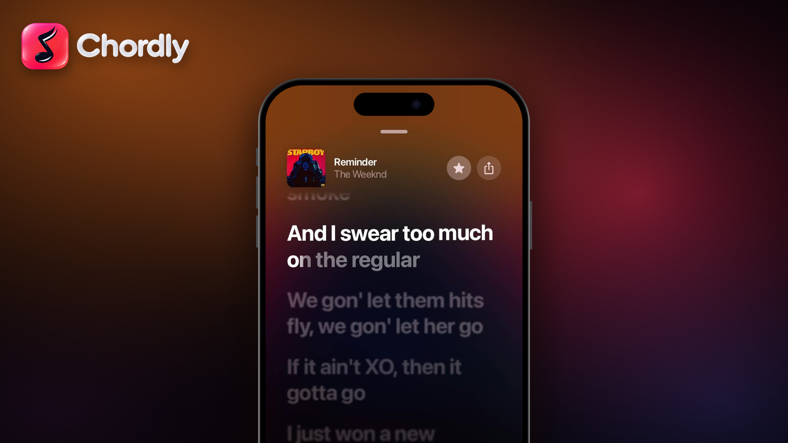
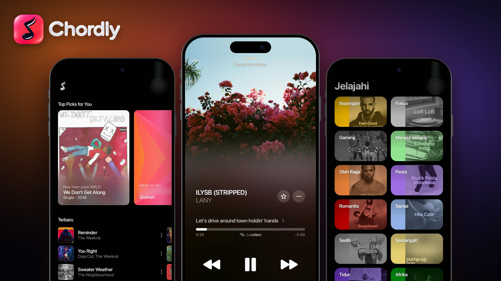

<div align="center">



<br/>

# Chordly

### Rasakan setiap lirik. Nikmati setiap nada.
**Pemutar musik modern untuk YouTube Music: tampil cantik, terasa ringan, dan dibuat untuk pendengar sejati.**

<br/>

[](https://github.com/Callmerev95/Chordly/releases/latest)
[](https://github.com/Callmerev95/Chordly/releases)
[](#-status-platform)
[](https://github.com/Callmerev95/Chordly/stargazers)
[](LICENSE)

<br/>

[**⬇️ Unduh**](#-unduh) &nbsp;·&nbsp;
[**✨ Fitur**](#-fitur-unggulan) &nbsp;·&nbsp;
[**🎬 Tampilan**](#-tampilan) &nbsp;·&nbsp;
[**🗺️ Roadmap**](#%EF%B8%8F-roadmap) &nbsp;·&nbsp;
[**❓ FAQ**](#-faq) &nbsp;·&nbsp;
[**🤝 Kontribusi**](#-kontribusi)

</div>

<br/>

---

## 🎧 Tentang Chordly

**Chordly** adalah aplikasi pemutar musik untuk **YouTube Music** yang dirancang dengan satu keyakinan sederhana: mendengarkan musik harus terasa menyenangkan, bukan hanya berfungsi.

Dengan antarmuka gelap yang elegan, **lirik tersinkronisasi** yang tampil besar dan jelas, serta warna latar yang menyesuaikan sampul lagu, setiap lagu yang kamu putar terasa seperti punya panggungnya sendiri.

> 🇮🇩 Dikembangkan dengan sepenuh hati oleh **Callmerev** dari Indonesia.

<br/>

## 📡 Status Platform

Chordly dibangun untuk hadir di banyak layar. Saat ini versi **mobile sudah stabil dan siap dipakai**, sementara platform lain sedang dalam perjalanan.

| Platform | Status | Keterangan |
| :--- | :---: | :--- |
| 📱 **Mobile (Android)** | ✅ **Stabil** | Tersedia sekarang, [unduh APK](#-unduh) |
| 📺 **TV** | 🔜 **Segera hadir** | Nikmati Chordly di layar besar |
| 🖥️ **Desktop** | 🔜 **Segera hadir** | Pengalaman penuh di komputermu |
| ⌚ **Wear OS** | 🔜 **Segera hadir** | Kendalikan musik dari pergelangan tangan |

<br/>

## 🎬 Tampilan

<div align="center">

</div>

<br/>

<div align="center">

| 🏠 Beranda | 🎵 Pemutar | 🧭 Jelajahi |
| :---: | :---: | :---: |
| Pilihan lagu pilihan untukmu, stasiun personal, dan daftar lagu terbaru | Sampul layar penuh, kontrol lengkap, dan indikator kualitas | Temukan musik berdasarkan suasana hati dan genre |

</div>

<br/>

## ✨ Fitur Unggulan

<table>
<tr>
<td width="50%" valign="top">

### 🎤 Lirik Tersinkronisasi
Ikuti setiap baris lirik secara real-time. Baris yang sedang dinyanyikan tampil menonjol, sementara baris lain memudar lembut di latar belakang.

</td>
<td width="50%" valign="top">

### 🎨 Warna yang Hidup
Latar gradient menyesuaikan warna sampul lagu, sehingga setiap lagu punya suasana visualnya sendiri.

</td>
</tr>
<tr>
<td width="50%" valign="top">

### 🏠 Beranda yang Personal
Dapatkan **Top Picks for You**, stasiun **Made for You**, dan daftar **Terbaru** langsung dari akun YouTube Music-mu.

</td>
<td width="50%" valign="top">

### 🧭 Jelajahi Berdasarkan Suasana
Dari **Fokus** dan **Santai** sampai **Olah Raga**, **Pesta**, dan **Tidur**. Temukan musik yang pas untuk momen apa pun.

</td>
</tr>
<tr>
<td width="50%" valign="top">

### 🎚️ Pemutar Lengkap
Sampul layar penuh, bilah progres, kontrol volume, tombol antrean dan cast, serta indikator kualitas **Lossless**.

</td>
<td width="50%" valign="top">

### ▶️ Mini Player Pintar
Terus kendalikan lagu sambil menjelajah. Mini player selalu siap di bagian bawah layar.

</td>
</tr>
<tr>
<td width="50%" valign="top">

### ⭐ Favorit & Bagikan
Simpan lagu kesukaanmu dengan satu ketukan dan bagikan ke teman kapan saja.

</td>
<td width="50%" valign="top">

### 🔐 Masuk dengan Google
Login dengan akun Google langsung dari halaman **Home**, cepat dan tanpa langkah yang berbelit.

</td>
</tr>
<tr>
<td colspan="2" valign="top">

### 📦 Satu APK untuk Semua HP
Cukup satu berkas **universal**. Berjalan di perangkat Android **ARM64, ARM32, dan x86_64**.

</td>
</tr>
</table>

<br/>

## ⬇️ Unduh

Dapatkan versi terbaru dari halaman **Releases**.

<div align="center">

[](https://github.com/Callmerev95/Chordly/releases/latest)

</div>

| Berkas | Ukuran | Kompatibilitas |
| :--- | :---: | :--- |
| `app-prod-universal-release.apk` | ± 186 MB | ARM64 · ARM32 · x86_64 |

<br/>

## 🛠️ Instalasi

<details open>
<summary><b>📱 Pasang di Android</b></summary>

<br/>

1. **Unduh** berkas `app-prod-universal-release.apk` dari halaman [Releases](https://github.com/Callmerev95/Chordly/releases/latest).
2. Buka **Pengaturan → Keamanan** (atau **Aplikasi**), lalu izinkan **instalasi dari sumber tidak dikenal** untuk browser atau file manager yang kamu gunakan.
3. Buka berkas APK yang sudah diunduh, lalu ketuk **Instal**.
4. Buka **Chordly**, lalu **masuk dengan akun Google** dari halaman Home.
5. Selamat mendengarkan! 🎶

</details>

**Persyaratan:**
- Perangkat Android <!-- TODO: isi versi minimum, misalnya Android 8.0 (API 26) atau lebih baru -->
- Koneksi internet
- Akun Google / YouTube Music

<br/>

## 🗺️ Roadmap

- [x] 📱 **Aplikasi mobile Android**: stabil dan tersedia
- [x] 🎤 Lirik tersinkronisasi
- [x] 🔐 Masuk dengan Google dari halaman Home
- [ ] 📺 **Chordly untuk TV**: *segera hadir*
- [ ] 🖥️ **Chordly untuk Desktop**: *segera hadir*
- [ ] ⌚ **Chordly untuk Wear OS**: *segera hadir*

> 💡 Punya ide fitur? Sampaikan lewat [Issues](https://github.com/Callmerev95/Chordly/issues).

<br/>

## 📝 Changelog

<details open>
<summary><b>v1.9.1: Perbaikan Sign-in Google</b></summary>

<br/>

Rilis pemeliharaan yang berfokus pada stabilitas proses login.

- ✅ Sign-in Google kini bisa dilakukan langsung dari halaman **Home**, tanpa perlu membuka Settings.
- ✅ Tombol **Lanjut** setelah memasukkan email kini berfungsi normal.
- ✅ Masalah lag, freeze, dan redirect berulang saat login telah diatasi.
- ℹ️ Tidak ada fitur baru dan tidak ada perubahan pada backend.

</details>

Riwayat lengkap tersedia di halaman [Releases](https://github.com/Callmerev95/Chordly/releases).

<br/>

## ❓ FAQ

<details>
<summary><b>Apakah Chordly gratis?</b></summary>
<br/>
<!-- TODO: sesuaikan dengan kebijakan yang kamu pilih -->
Ya, Chordly dapat diunduh dan digunakan secara gratis.
</details>

<details>
<summary><b>Apakah saya wajib punya akun YouTube Music?</b></summary>
<br/>
Chordly menggunakan akun Google / YouTube Music-mu untuk menghadirkan rekomendasi dan koleksi yang personal. Masuk dengan Google dari halaman Home untuk pengalaman terbaik.
</details>

<details>
<summary><b>HP saya didukung?</b></summary>
<br/>
Ya. APK universal Chordly mendukung perangkat Android dengan arsitektur ARM64, ARM32, dan x86_64.
</details>

<details>
<summary><b>Kapan versi TV, Desktop, dan Wear OS rilis?</b></summary>
<br/>
Ketiganya sedang dalam rencana pengembangan dan akan hadir segera. Pantau halaman <a href="https://github.com/Callmerev95/Chordly/releases">Releases</a> dan beri ⭐ pada repositori ini agar tidak ketinggalan kabar.
</details>

<details>
<summary><b>Saya menemukan bug. Harus bagaimana?</b></summary>
<br/>
Buka <a href="https://github.com/Callmerev95/Chordly/issues">Issue</a> baru dan sertakan versi aplikasi, tipe perangkat, versi Android, serta langkah untuk mereproduksi masalahnya. Screenshot atau rekaman layar sangat membantu.
</details>

<br/>

## 🧑‍💻 Pengembangan

<!-- TODO: sesuaikan dengan stack dan langkah build yang sebenarnya -->

```bash
# Clone repositori
git clone https://github.com/Callmerev95/Chordly.git
cd Chordly

# TODO: tambahkan langkah build, misalnya:
# ./gradlew assembleDebug
```

**Stack teknologi:** <!-- TODO: misalnya Kotlin · Jetpack Compose · Media3/ExoPlayer, dll. -->

<br/>

## 🤝 Kontribusi

Kontribusi dalam bentuk apa pun sangat disambut, baik kode, laporan bug, ide fitur, maupun perbaikan dokumentasi.

1. 🍴 **Fork** repositori ini
2. 🌿 Buat branch baru: `git checkout -b fitur/nama-fitur`
3. 💾 Commit perubahanmu: `git commit -m "feat: deskripsi singkat"`
4. 🚀 Push ke branch: `git push origin fitur/nama-fitur`
5. 🔃 Buka **Pull Request**

<br/>

## 📄 Lisensi

<!-- TODO: sesuaikan dengan lisensi yang kamu pilih, lalu pastikan berkas LICENSE ada di repo -->
Didistribusikan di bawah lisensi **GPL-3.0**. Lihat berkas [`LICENSE`](LICENSE) untuk detail lengkap.

## ⚠️ Disclaimer

Chordly adalah proyek independen dan **tidak berafiliasi dengan, disponsori, atau didukung oleh Google maupun YouTube**. Seluruh konten musik, merek dagang, dan hak cipta adalah milik pemegang haknya masing-masing. Gunakan aplikasi ini sesuai dengan Ketentuan Layanan YouTube dan Google.

<br/>

---

<div align="center">

### 💖 Suka dengan Chordly?

Beri **⭐ bintang** pada repositori ini dan bagikan ke teman-temanmu.<br/>
Dukunganmu adalah bahan bakar untuk versi TV, Desktop, dan Wear OS.

<br/>

**Build with ❤️ by [Callmerev](https://callmerev.my.id)**

</div>
