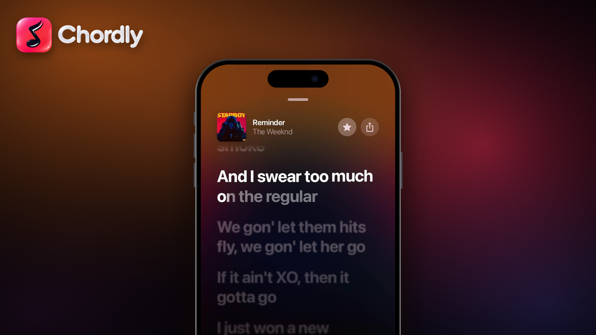

## Hotfix

A small release on top of v1.9, fixing Google sign-in and the in-app update flow.

## Changelog

- Sign-in: the login form uses Google's official account page again, and the "Use this profile" confirmation no longer gets stuck after signing in.
- Updates: the in-app download now sends the credentials the private repository requires, so it no longer fails with HTTP 404.
- Update dialog: the "Open Releases Page" option is removed, since the repository is private and its pages cannot be opened in a browser.

## Install

**Android** (8.0 / API 26+): installs straight over v1.9 with the same signing key. Not sure which APK to take? Use the universal `app-prod-universal-release.apk`. The smaller ones are `arm64-v8a` (most phones), `armeabi-v7a` (old 32-bit phones) and `x86_64` (emulators, Chromebooks).
